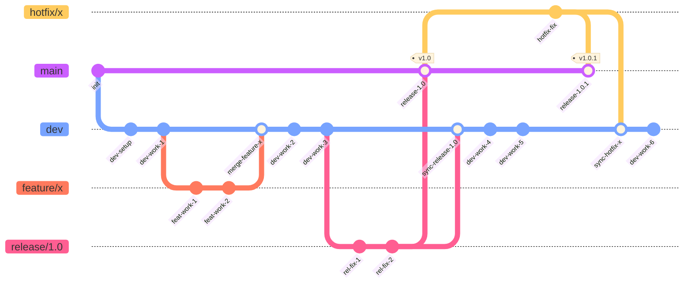

# Solvix

## Stack

- **Backend:** .NET 8 (C#)
- **Frontend:** Angular 18
- **Database:** PostgreSQL

## Backend

The backend is split into 5 .NET projects, following Dependency Inversion (Ports & Adapters): every project depends only on `Solvix.Contracts`, never on each other directly, so there are no circular dependencies and each piece can be changed or tested in isolation.

- **`Solvix.Contracts`** — interfaces and message/DTO types only. No logic, no dependencies. The shared language every other project speaks.
- **`Solvix.Mesh`** — the domain model of the CAD editor: curvilinear 20-node hexahedra (`Hex20`) assembled face-to-face in a `HexMesh`, with explicit neighbour links, shared nodes, the real/ideal world mapping and a solver-ready `FemMeshData` export. Pure library, no dependencies. Tests in `Solvix.Mesh.Tests`.
- **`Solvix.Fem`** — the finite element core: 20-node hexahedron (shape functions, `BᵀDB` stiffness, face pressure, element quality), materials as 6×6 matrices, sparse assembly and a preconditioned CG solver. Pure maths, no dependencies; ported from the original `Solution1/FemSolver` with its Jacobian bug fixed (see `docs/REVIEW.md`).
- **`Solvix.Solver`** — the solver as a service, exposed behind a facade: per-session set-up (materials, supports, pressures, division of cubes into small elements), validation, background solve with progress. Depends on `Contracts` and `Fem`.
- **`Solvix.MeshBuilder`** — mesh construction and local refinement logic, exposed behind a facade. Depends only on `Contracts`.
- **`Solvix.Bridge`** — relay between `Solver` and `MeshBuilder`. Routes calls/events both ways (via `Contracts` interfaces, e.g. pub/sub for one side proactively pushing to the other) and can hold cross-cutting logic (validation, mapping, etc.) if the two sides' data models diverge. Never references `Solver`/`MeshBuilder` directly.
- **`Solvix.Data`** — persistence (EF Core + PostgreSQL). Implements storage interfaces declared in `Contracts` (projects/meshes, solve results). Depends only on `Contracts` — `Solver` and `MeshBuilder` never touch the database directly; `Api` orchestrates saving/loading.
- **`Solvix.Api`** — the composition root: the only project that references everything. Wires up DI at startup and exposes HTTP/SignalR endpoints to the Angular frontend (`solvix-web`).

```
Solvix.Contracts   ← (nothing)
Solvix.Solver      ← Contracts
Solvix.MeshBuilder ← Contracts
Solvix.Bridge      ← Contracts
Solvix.Data        ← Contracts
Solvix.Api         ← Contracts, Solver, MeshBuilder, Bridge, Data
```

### Project documents

- [`docs/REVIEW.md`](docs/REVIEW.md) — full review: state, what is right, what is wrong, market comparison.
- [`docs/FIX_LIST.md`](docs/FIX_LIST.md) — what to fix to reach a clean 100 % state.
- [`docs/ROADMAP.md`](docs/ROADMAP.md) — what to add next (geometry → local refinement → solver).

### Tests

- **`Solvix.Fem.Tests`** — element, quality and material tests (NUnit).

- **`Solvix.Solver.Tests`** — unit tests for `Solvix.Solver` (NUnit).
- **`Solvix.MeshBuilder.Tests`** — unit tests for `Solvix.MeshBuilder` (NUnit).

## Running locally

See [`docs/RUNNING.md`](docs/RUNNING.md) for how to start the full stack (dev mode with hot reload, or full Docker mode), including Colima/Docker setup and troubleshooting.

## Branching strategy

This project follows **Git Flow**:

- `main` — always stable, release-ready code. Never committed to directly.
- `dev` — integration branch for all features and regular fixes.
- `feature/*` — new functionality, branched from `dev`, merged back into `dev`.
- `fix/*` — regular (non-critical) bug fixes, branched from `dev`, merged back into `dev`.
- `release/<version>` — release stabilization, branched from `dev`, merged into both `main` and `dev`, then deleted.
- `hotfix/*` — critical production fixes, branched from `main`, merged into both `main` and `dev`.



Full details: [`docs/BRANCHING.md`](docs/BRANCHING.md).