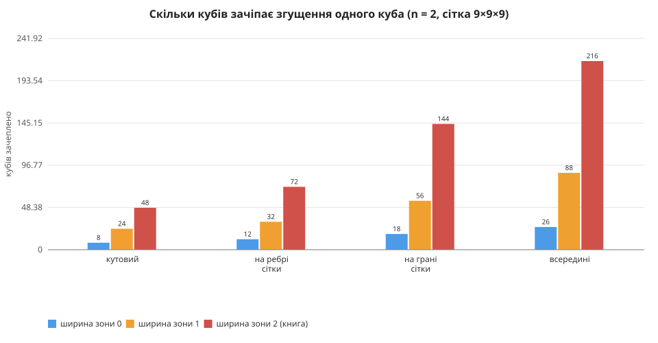
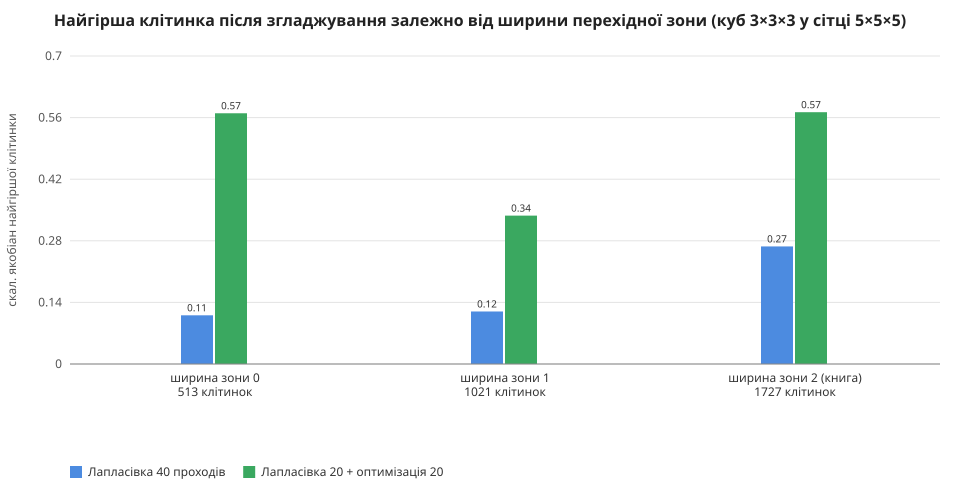
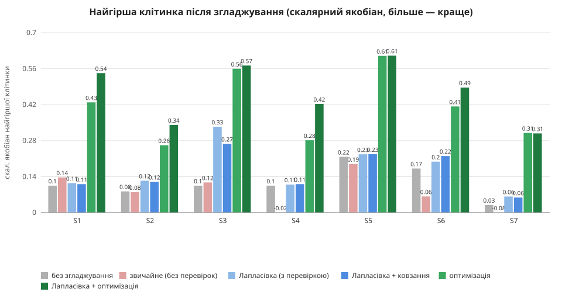
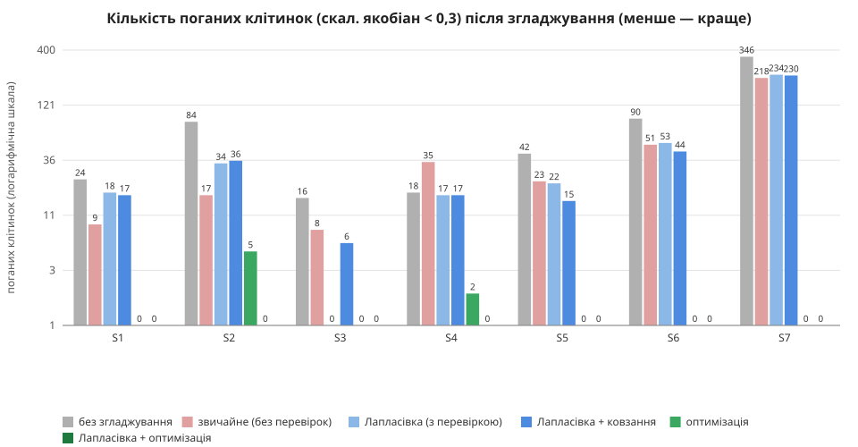
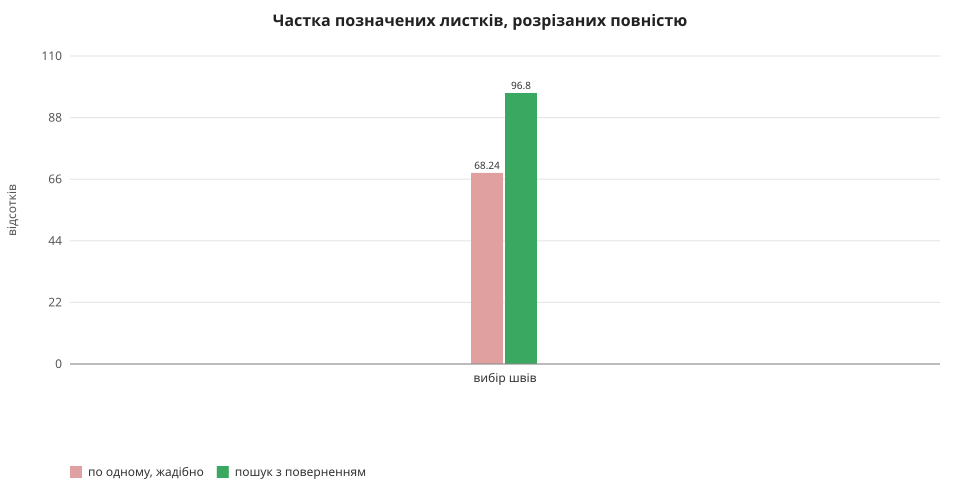
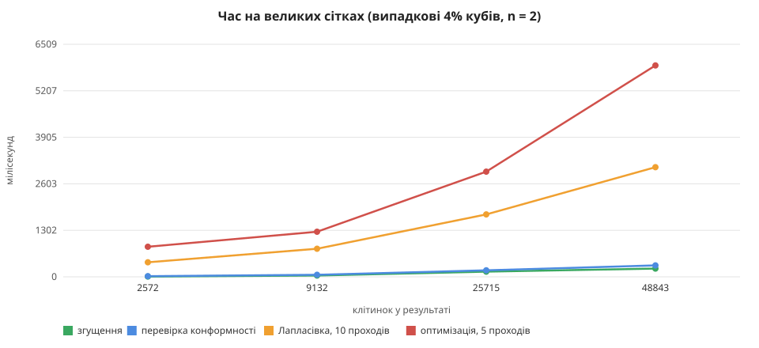

# Локальне згущення гексаедральної сітки в 3D: дослідження

Цей документ — запис того, як зроблено локальне згущення (2-refinement шаблонами, Owen, Shih, Ernst 2016) для гексаедральних сіток, **що пішло не
так**, які вимірювання це показали і що з цього зрозуміли. Кожне число в таблицях отримане запуском коду з репозиторію (розділ «Як відтворити»);
чисел «з пам'яті» тут немає.

Код: `Refinement3D/Refinement3D.Core` (бібліотека), `Refinement3D.Api` (API), `refinement3d-web` (сторінка). Попередній двовимірний варіант, на якому
алгоритм відпрацьований, — `Refinement2D`. Тести: `Refinement3D.Tests` (понад 45 перевірок). Це окремий проєкт, не пов'язаний із кодом Solvix:
інтеграція в Solvix — наступний етап (розділ 8).

---

## 1. Постановка

Користувач вибирає множину кубів M і числа поділу (nI, nJ, nK). Кожен куб із M треба поділити рівномірно на nI × nJ × nK дітей. Якщо поділити тільки
M, на межі з нерозділеними сусідами з'являються **висячі вузли**: вузли дрібної сторони, яких немає на грані сусіда, і МСЕ-розрахунок через такий
шов хибний. Потрібні **перехідні шаблони** для сусідів, які дають на спільних гранях ту саму сітку з обох боків, залишаючи все гексаедрами.

Вимоги користувача, у порядку появи:

1. Усе рахується на **ідеальній цілочисельній решітці**: вузли — цілі числа, ніяких допусків і «майже збігається».
2. Шаблони **T1, T2, T4** (T3 не використовується), довільні nI, nJ, nK ≥ 2. Без поширення міток (node propagation): якість виправляє згладжування.
3. **Плоска ієрархія в один рівень:** корінь → список листків; клітинка, що ділиться, **замінює себе** дітьми.
4. Клітинка з M ділиться **повністю** (по всіх осях), у тому числі листок попереднього згущення, який не лежить на шві.
5. Спершу двовимірний варіант («якщо зрозуміти 2D, зрозуміємо 3D»), з пошаговим показом.
6. **Результат якісний і без багів**: валідатор конформності, випадкові тести, виміряна швидкість.
7. Згладжування, яке **не псує поверхню тіла**, і яке справді покращує найгірші клітинки.

## 2. Терміни

| Термін | Що це |
|---|---|
| Корінь | клітинка початкової грубої решітки; в ній лежать листки |
| Листок | клітинка сітки зараз (гексаедр із 8 вузлів у канонічному порядку: слот = біт0 + 2·біт1 + 4·біт2) |
| M | множина клітинок, які треба згустити (вибрані користувачем і те, що з них виходить) |
| Шов | площина між двома шарами кореневої решітки, складеними в пару «парний + непарний» |
| Мітка | вузол, позначений на шві; шаблон розрізає ребро тоді й лише тоді, коли рівно один його кінець позначений |
| Дозволений візерунок міток у клітинці | немає міток (нічого), одна (кут → T1), дві на ребрі (T2), чотири на грані (T4), усі вісім (не ділиться) |
| Замикання | дописування міток у клітинках із недозволеним візерунком до найменшого дозволеного (грань, що містить усі мітки, або всі вісім) |
| Ширина перехідної зони | 0, 1 або 2: після скількох проходів усе, що розділено (разом із перехідними шарами), додається в M; 2 — як у книзі |
| Скал. якобіан клітинки | найменше за 8 кутами det/(\|a\|\|b\|\|c\|) трьох ребер у куті; 1 — прямокутник, ≤ 0 — вивернута |
| Погана клітинка | скал. якобіан < 0,3 |

## 3. Алгоритм

Для кожної осі I, J, K по черзі:

1. **Мітки.** Шари кореневої решітки вздовж осі складаються в пари (0,1), (2,3), … по всій сітці (тоді шви збігаються і через дірки). Клітинка з M, що має грань
   на шві своєї пари, позначає 4 вузли цієї грані.
2. **Власний шов.** Клітинка з M, яка до шва не дістає (глибше за шов у корені; листок попереднього згущення), має бути розрізана впоперек осі, тобто
   мати позначену **рівно одну** з двох граней упоперек осі (тоді шаблон T4: n пластин). Вибір граней для всіх таких клітинок робить пошук (розділ 5.2).
3. **Замикання** і перевірка шаблонів: якщо шаблон дав би вивернуту дитину (на перекошеному батьку), клітинка отримує більше міток.
4. **Шаблони:** кут → T1 (3n−2 дітей), ребро → T2 (2n−1), грань → T4 (n); клітинка з усіма 8 мітками не ділиться.
5. **Розширення M:** діти клітинок, які розділено, додаються в M (залежно від ширини зони: лише від клітинок користувача чи й від перехідних шарів).

Усі нові точки — це вершини батька або точки на k/n його ребер, або вершини «вкладених копій» батька, зменшених до кута; решітка перед проходом
помножується на n, тож усе — цілі числа. Діти будуються з кутів і ставляться в слоти за осями решітки (орієнтація дитини = орієнтація батька).

### 3.1. Три шаблони

* **T4 (позначена грань).** n пластин, паралельних грані; сама грань лишається цілою.
* **T2 (позначене ребро).** Двовимірний T1 у перерізі, витягнутий уздовж ребра: n вкладених «труб», між сусідніми по два «крила», 2n−1 дітей. Ребро ціле.
* **T1 (позначений кут).** n вкладених копій батька, зменшених до кута; між сусідніми три плити (по осях X, Y, Z), у найменшій — кубик у куті; 3n−2 дітей.
  Три ребра з кута діляться на n частин, решта ребер цілі.

Діагональні грані між плитами T1/T2 мають особливість: грань осі X однієї клітинки збігається з гранню осі Y сусідньої (розділ 7.1).

## 4. Що пішло не так (і що з цього зрозуміли)

Усе нижче було знайдено вимірюванням або тестом, а не здогадкою.

| # | Що | Як проявилося | Що зробили |
|---|---|---|---|
| 1 | У 2D шов позначав **усе** ребро кореня, якщо в корені була хоч одна клітинка з M | точка на ребрі білої клітинки, яка не в M (ваш скріншот) | позначаються лише ребра клітинок M, що лежать на шві (так у книзі) |
| 2 | Ідея «нумерувати клітинки по хордах нової сітки» для вибору шва | у T1-оболонці хорда виходить через бокове ребро; замкнені хорди не мають початку; нуль залежить від порядку клітинок у пам'яті | відкинув: книга рахує **шари вихідної сітки**, а не хорди |
| 3 | Вибір власного шва клітинки по одній, жадібно | у 3D лише **68%** позначених листків ділиться повністю | пошук для всіх клітинок разом із поверненням назад: **97%** (розділ 5.4) |
| 4 | Книжкове розширення M після кожного проходу | куб у куті сітки зачіпає **48** кубів, посередині **216** | ширина перехідної зони 0/1/2, за замовчуванням 0 (розділ 5.1) |
| 5 | Шаблон T1/T2 на перекошеному листку | вивернута дитина (від'ємний якобіан) | перевірка шаблону до застосування; клітинка отримує більше міток |
| 6 | Якобіан у `long` | `OverflowException` після кількох згущень поспіль | 128 біт + межа координат 2⁴⁰; згущення, що не влізає, відхиляється з повідомленням |
| 7 | Пошук швів рекурсією | **вихід за стек і падіння всього процесу** на великому блоці кубів (знайдено вимірюванням швидкості на блоках 4³–8³) | пошук без рекурсії; тест на потоці зі стеком 256 КБ |
| 8 | Лапласівка «як усі» | у першому вимірюванні на 30 випадкових сітках середня якість (за відношенням якобіанів) **падала** з 0,706 до 0,615; у S4 і S7 з'являються вивернуті клітинки | «розумна» Лапласівка: вузол іде, лише якщо найгірша клітинка навколо не гіршає і сума якостей зростає |
| 9 | Навіть розумна Лапласівка | найгірша клітинка росте мало (0,105 → 0,111) | оптимізаційне згладжування (розділ 5.2) |

## 5. Вимірювання

Усі таблиці й графіки створює `Refinement3D.Tests/Study.cs` (розділ 9); значення точні, дані — ті, що в `study-output.md`.

### 5.1. Скільки кубів чіпає згущення і що це дає



Книжкове розширення (ширина 2) розганяє згущення: для кутового куба в 6 разів більше кубів, ніж потрібно (48 проти 8), для куба посередині в 8 разів
(216 проти 26). Мінімальна зона (0) чіпає саме те, що потрібно для стикування.

**Що це означає для якості.** До згладжування якість у зон 0 і 2 однакова (найгірша 0,105 при n=3; таблиця B): найгірші клітинки сидять у перехідних шарах,
які однакові. Ширина 1 вийшла **гіршою** за обидві (найгірша 0,083, погані клітинки 84 проти 24): вона обриває зону посеред шаровання, і плити T1/T2
стикаються гірше. Тому проміжна ширина як параметр — не «золота середина»; чесно: корисні 0 і 2.



Ваша гіпотеза — «ширша перехідна зона дає кращий результат після згладжування» — **підтвердилась для Лапласівки**: найгірша клітинка 0,115 при ширині 0 і
0,334 при ширині 2 (нерухома поверхня), але **не підтвердилась як необхідна умова для оптимізації**: з Лапласівкою і оптимізацією найгірша клітинка така: 0,54 при ширині 0 і 0,57
при ширині 2 (самою оптимізацією 0,43 і 0,56), тобто платити втричі більшою сіткою (513 → 1727 клітинок) за ширшу зону не потрібно.

### 5.2. Згладжування: порівняння методів

«Звичайне» — те, що роблять зазвичай: вузол іде до простого середнього сусідів, поверхня нерухома, нічого не перевіряється. Решта — мої.





* **Звичайне згладжування нестабільне.** У S4 (кутовий куб) і S7 (повторне згущення) воно **виверта клітинки** (найгірша від'ємна: −0,020 і −0,077), у S6
  зменшує найгіршу з 0,171 до 0,063. Така сітка для розрахунку непридатна. Усі мої методи вивернутих не дають ніколи.
* **Розумна Лапласівка безпечна, але слабка**: найгірша лишається біля 0,11 у S1 (куб посередині) і в S4, хоча середня росте.
* **Оптимізація** підіймає найгіршу клітинку в **1,9–5,3 разів вище**, ніж розумна Лапласівка з ковзанням (S1: 0,111 → 0,429, S3: 0,267 → 0,560, S5: 0,227 → 0,610,
  S7: 0,058 → 0,310), і в 2,4–10 разів вище, ніж до згладжування (S7: 0,030 → 0,310). Вона **знімає погані клітинки**: S1 24 → 0, S5 42 → 0, S6 90 → 0, S7 346 → 0
  (у S2 84 → 5 і у S4 18 → 2; з Лапласівкою перед нею 0).
* Об'єм сітки не змінюється (різниця порядку 1e-11 — похибка округлення): поверхня тіла збережена.
* **Ковзання по поверхні** — не завжди виграш для Лапласівки: на поганих клітинках S3 найгірша гірша (0,267 проти 0,334 з нерухомою поверхнею), зате в S5 погані клітинки
  22 → 15, у S6 53 → 44. Для оптимізації воно потрібне: вузли поверхні — частина найгірших клітинок.

Що **не** вдалося: у S2 і S7 після оптимізації найгірша клітинка лише 0,26–0,31, а не 0,5–0,6: її обмежує жорстка сусідня сітка. Середня якість теоретично може
трохи знижуватися (оптимізація мінімізує штраф за скошені кути, а не середнє); у вимірюваннях вона росте в усіх сімох сценаріях (наприклад, S1 0,730 → 0,829, S7 0,635 → 0,708).

### 5.3. Пошук швів: частка листків, розрізаних повністю



Клітинка з M, яка не лежить на шві, мусить отримати свою позначену грань упоперек осі. Вибір по одному (жадібно) лишає 32% листків недорізаними, бо
вибір грані для однієї клітинки псує сусідню. Пошук з поверненням, який вибирає грані для всіх клітинок групи разом, розрізає **97%**. Решта 3% — випадки, коли
знайти узгоджений вибір не вдалося (серед причин — діагональні грані плит T1 і T2 з різними осями, розділ 7.1); їх видно червоним, сітка лишається конформною.

### 5.4. Швидкість



Згущення і перевірка конформності — соті частки секунди на десятки тисяч клітинок (48 843 клітинок за 0,22 с і 0,32 с). Найдорожче згладжування: 10 проходів
Лапласівки на 48 843 клітинках — 2,9 с, 5 проходів оптимізації — 5,3 с. Вузли розбито на групи, що не мають спільних клітинок, і група обробляється паралельно;
результат **однаковий при будь-якій кількості потоків** (тест порівнює 1 потік, 8 потоків і режим за замовчуванням на сітці з понад 2000 клітинок: позиції збігаються точно). Згладжування — вузьке місце, але воно йде у фоні з індикатором і кнопкою «Зупинити».

## 6. Гарантії і як вони перевірені

| Гарантія | Чим перевірено |
|---|---|
| Результат конформний: жодних висячих вузлів, дірок, перекриттів | валідатор `Conformity` після кожного випадкового згущення (сотні сіток із дірками, n від 2 до 10, два рівні) |
| Кожна позначена клітинка першого рівня ділиться **рівно** nI·nJ·nK | випадкові тести |
| Листок попереднього згущення ділиться повністю в 97% і ніколи не «мовчки» ні | тест покриття; решта звітується |
| Результат не залежить від порядку позначених клітинок і повторюється точно | тести порядку й повтору |
| Жодної вивернутої клітинки після згладжування, найгірша клітинка не гіршає | тести згладжування і оптимізації |
| Форма тіла збережена: вузли поверхні нерухомі або ковзають у площині своєї грані, об'єм не змінюється | тести (точна рівність координат, об'єм до 1e-9) |
| Велике виділення не валить процес | тест на потоці зі стеком 256 КБ |
| Решітка не переповнюється | тест глибини: згущення, що не влізає, відхиляється, сітка не змінюється |

Усього в `Refinement3D.Tests` 45 перевірок (у `Refinement2D.Tests` ще 30), усі проходять.

## 7. Обмеження і відкриті питання

1. **Діагональні грані.** Плити T1/T2 стикуються так, що грань осі X однієї клітинки збігається з гранню осі Y сусідньої (374 таких граней із 765 клітинок при n=3 у режимі книги, ширина зони 2).
   Геометрія правильна, але `HexFace.PartnerSlot` у Solvix припускає, що сусіди завжди з'єднані одноіменними гранями. Це **головна перешкода інтеграції**.
2. **3% листків** при повторному згущенні лишаються недорізаними, коли виділення містить перехідні плити (розділ 5.3).
3. **Решітка дрібнішає** у nI·nJ·nK разів за згущення; межа 2⁴⁰ у вимірюванні (таблиця F) дає **12 згущень поспіль** того самого кута при n=2, 8 при n=3, 6 при n=4 і 4 при n=8. Це в тисячі разів дрібніше за вихідну клітинку; для більшого запасу потрібна решітка з окремим масштабом по осях.
4. **Ширина 1** гірша за 0 і 2 (розділ 5.1).
5. Оптимізація не гарантує зростання **середньої** якості (гарантує найгіршу клітинку і суму штрафів).
6. Повторне згущення вже згущеного та редагування після нього детально не обговорювались.
7. Ми не шукали аналоги в літературі: «новизна» нижче — порівняно зі статтею Owen, Shih, Ernst і зі «звичайним» згладжуванням, виміряним тут.

## 8. Що нового порівняно зі статтею і зі звичайним підходом

* Стаття описує лише 2-refinement (n = 2). Тут **довільні nI, nJ, nK ≥ 2** на кожну вісь, на точній цілочисельній решітці.
* Стаття не розглядає **повторне згущення** листків; тут воно працює (97% повністю, решта звітується), з пошуком швів для клітинок, які не лежать на шві.
* **Ширина перехідної зони** — параметр: 8 кубів замість 48 для кутового куба й 26 замість 216 для середнього, без втрати якості після оптимізації.
* **Згладжування, що зберігає форму тіла** (вузли поверхні нерухомі чи ковзають у площині грані) і дає гарантії: жодної вивернутої клітинки, найгірша не гіршає.
* **Оптимізація** піднімає найгіршу клітинку в 2,5–5,8 разів проти розумної Лапласівки і знімає погані клітинки там, де звичайне згладжування їх виворочує.
* Валідатор конформності і 45 тестів, у тому числі випадкові, на малому стеку, на переповнення.

## 9. Як відтворити

```bash
cd Refinement3D
dotnet test Refinement3D.Tests                                    # усі перевірки (≈ 1 хв)
STUDY_OUT=../docs/research/local-refinement-3d/study-output.md \
STUDY_IMG=../docs/research/local-refinement-3d/img \
dotnet test Refinement3D.Tests --filter Name=Run                  # дослідження: таблиці й графіки (≈ 1,5 хв)
dotnet run --project Refinement3D.Api                             # API, http://localhost:5191
cd refinement3d-web && npm install && npm run dev                 # сторінка, http://localhost:5174
```

Таблиці розділу 10 — дослівний вивід `Study.cs`.

---

## 10. Усі таблиці дослідження

### A. Скільки кубів зачіпає згущення одного куба (сітка 9×9×9, n = 2×2×2)

| куб | ширина зони | кубів зачеплено | клітинок у результаті |
|---|---|---|---|
| кутовий | 0 | 8 | 797 |
| кутовий | 1 | 24 | 857 |
| кутовий | 2 (книга) | 48 | 915 |
| на ребрі сітки | 0 | 12 | 821 |
| на ребрі сітки | 1 | 32 | 897 |
| на ребрі сітки | 2 (книга) | 72 | 989 |
| на грані сітки | 0 | 18 | 851 |
| на грані сітки | 1 | 56 | 1007 |
| на грані сітки | 2 (книга) | 144 | 1239 |
| всередині | 0 | 26 | 887 |
| всередині | 1 | 88 | 1103 |
| всередині | 2 (книга) | 216 | 1535 |

### B. Якість сітки відразу після згущення (куб посередині сітки 5×5×5, до згладжування)

| n | ширина зони | клітинок | найгірша (скал. якобіан) | середня | погані (< 0,3) |
|---|---|---|---|---|---|
| 2 | 0 | 283 | 0,217 | 0,797 | 6 |
| 2 | 1 | 499 | 0,136 | 0,728 | 23 |
| 2 | 2 | 746 | 0,217 | 0,757 | 6 |
| 3 | 0 | 513 | 0,105 | 0,730 | 24 |
| 3 | 1 | 1021 | 0,083 | 0,684 | 84 |
| 3 | 2 | 1727 | 0,105 | 0,734 | 16 |
| 4 | 0 | 827 | 0,061 | 0,707 | 81 |
| 4 | 1 | 1715 | 0,046 | 0,673 | 252 |
| 4 | 2 | 3116 | 0,061 | 0,731 | 222 |

### C. Згладжування: порівняння методів (поверхня тіла скрізь збережена)

«Звичайне» — те, що роблять зазвичай: кожен внутрішній вузол іде до простого середнього сусідів, поверхня нерухома, нічого не перевіряється (20 проходів, крок 0,5). Усі інші методи — мої.

**S1: куб посередині 5×5×5, n=3, зона 0** — 513 клітинок

| метод | найгірша | середня | погані | вивернуті | зміна об'єму | час, мс |
|---|---|---|---|---|---|---|
| без згладжування | 0,105 | 0,730 | 24 | 0 | 0 | 0 |
| звичайне (без перевірок) | 0,137 | 0,746 | 9 | 0 | -5,3e-12 | 8 |
| Лапласівка з перевіркою, нерухома поверхня | 0,115 | 0,768 | 18 | 0 | -5,2e-12 | 531 |
| Лапласівка з перевіркою + ковзання | 0,111 | 0,776 | 17 | 0 | -4,9e-12 | 580 |
| оптимізація (20 проходів) + ковзання | 0,429 | 0,829 | 0 | 0 | -5,3e-12 | 942 |
| Лапласівка 40 + оптимізація 20 + ковзання | 0,543 | 0,829 | 0 | 0 | -4,9e-12 | 1403 |

**S2: той самий, зона 1** — 1021 клітинок

| метод | найгірша | середня | погані | вивернуті | зміна об'єму | час, мс |
|---|---|---|---|---|---|---|
| без згладжування | 0,083 | 0,684 | 84 | 0 | 0 | 0 |
| звичайне (без перевірок) | 0,080 | 0,719 | 17 | 0 | -6,9e-12 | 14 |
| Лапласівка з перевіркою, нерухома поверхня | 0,124 | 0,723 | 34 | 0 | -6,1e-12 | 1142 |
| Лапласівка з перевіркою + ковзання | 0,119 | 0,721 | 36 | 0 | -6,8e-12 | 1253 |
| оптимізація (20 проходів) + ковзання | 0,262 | 0,759 | 5 | 0 | -6,9e-12 | 1786 |
| Лапласівка 40 + оптимізація 20 + ковзання | 0,341 | 0,779 | 0 | 0 | -7,0e-12 | 2881 |

**S3: той самий, зона 2 (книга)** — 1727 клітинок

| метод | найгірша | середня | погані | вивернуті | зміна об'єму | час, мс |
|---|---|---|---|---|---|---|
| без згладжування | 0,105 | 0,734 | 16 | 0 | 0 | 0 |
| звичайне (без перевірок) | 0,117 | 0,776 | 8 | 0 | -9,2e-13 | 24 |
| Лапласівка з перевіркою, нерухома поверхня | 0,334 | 0,782 | 0 | 0 | -1,2e-12 | 1934 |
| Лапласівка з перевіркою + ковзання | 0,267 | 0,781 | 6 | 0 | -1,5e-12 | 2053 |
| оптимізація (20 проходів) + ковзання | 0,560 | 0,814 | 0 | 0 | -2,2e-12 | 3330 |
| Лапласівка 40 + оптимізація 20 + ковзання | 0,572 | 0,822 | 0 | 0 | -1,9e-12 | 5303 |

**S4: кутовий куб 5×5×5, n=3, зона 0** — 309 клітинок

| метод | найгірша | середня | погані | вивернуті | зміна об'єму | час, мс |
|---|---|---|---|---|---|---|
| без згладжування | 0,105 | 0,825 | 18 | 0 | 0 | 0 |
| звичайне (без перевірок) | -0,020 | 0,771 | 35 | 1 | -1,9e-12 | 1 |
| Лапласівка з перевіркою, нерухома поверхня | 0,109 | 0,829 | 17 | 0 | -1,7e-12 | 205 |
| Лапласівка з перевіркою + ковзання | 0,111 | 0,845 | 17 | 0 | -1,6e-12 | 318 |
| оптимізація (20 проходів) + ковзання | 0,281 | 0,884 | 2 | 0 | -1,6e-12 | 425 |
| Лапласівка 40 + оптимізація 20 + ковзання | 0,423 | 0,885 | 0 | 0 | -1,7e-12 | 701 |

**S5: блок 3×3×3 у сітці 7×7×7, n=2, зона 0** — 1171 клітинок

| метод | найгірша | середня | погані | вивернуті | зміна об'єму | час, мс |
|---|---|---|---|---|---|---|
| без згладжування | 0,217 | 0,808 | 42 | 0 | 0 | 0 |
| звичайне (без перевірок) | 0,189 | 0,814 | 23 | 0 | 7,4e-12 | 5 |
| Лапласівка з перевіркою, нерухома поверхня | 0,227 | 0,827 | 22 | 0 | 8,5e-12 | 1187 |
| Лапласівка з перевіркою + ковзання | 0,227 | 0,828 | 15 | 0 | 8,4e-12 | 1292 |
| оптимізація (20 проходів) + ковзання | 0,610 | 0,839 | 0 | 0 | 6,9e-12 | 1775 |
| Лапласівка 40 + оптимізація 20 + ковзання | 0,611 | 0,843 | 0 | 0 | 9,9e-12 | 3033 |

**S6: розкидані куби (5%) у сітці 8×8×8, n=2, зона 0** — 2889 клітинок

| метод | найгірша | середня | погані | вивернуті | зміна об'єму | час, мс |
|---|---|---|---|---|---|---|
| без згладжування | 0,171 | 0,746 | 90 | 0 | 0 | 0 |
| звичайне (без перевірок) | 0,063 | 0,741 | 51 | 0 | 2,1e-11 | 14 |
| Лапласівка з перевіркою, нерухома поверхня | 0,198 | 0,762 | 53 | 0 | 2,5e-11 | 2489 |
| Лапласівка з перевіркою + ковзання | 0,220 | 0,769 | 44 | 0 | 2,1e-11 | 1616 |
| оптимізація (20 проходів) + ковзання | 0,413 | 0,784 | 0 | 0 | 2,1e-11 | 2223 |
| Лапласівка 40 + оптимізація 20 + ковзання | 0,487 | 0,787 | 0 | 0 | 1,8e-11 | 4109 |

**S7: повторне згущення листків, сітка 5×5×5** — 2793 клітинок

| метод | найгірша | середня | погані | вивернуті | зміна об'єму | час, мс |
|---|---|---|---|---|---|---|
| без згладжування | 0,030 | 0,635 | 346 | 0 | 0 | 0 |
| звичайне (без перевірок) | -0,077 | 0,660 | 218 | 2 | 4,4e-12 | 15 |
| Лапласівка з перевіркою, нерухома поверхня | 0,063 | 0,674 | 234 | 0 | 3,6e-12 | 3096 |
| Лапласівка з перевіркою + ковзання | 0,058 | 0,678 | 230 | 0 | 3,8e-12 | 2598 |
| оптимізація (20 проходів) + ковзання | 0,310 | 0,708 | 0 | 0 | 4,4e-12 | 3895 |
| Лапласівка 40 + оптимізація 20 + ковзання | 0,308 | 0,715 | 0 | 0 | 3,0e-12 | 6344 |

### D. Скільки позначених листків ділиться повністю (n = 2…3, листки попереднього згущення)

| вибір швів | листків перевірено | розрізано повністю | частка |
|---|---|---|---|
| по одному, жадібно | 1373 | 937 | 68,2% |
| пошук з поверненням (мій) | 1373 | 1329 | 96,8% |

### E. Швидкість на великих сітках (випадкові 4% кубів, n = 2×2×2, ширина зони 0)

| сітка | кубів обрано | клітинок у результаті | згущення, мс | перевірка конформності, мс | Лапласівка 10 проходів, мс | оптимізація 5 проходів, мс |
|---|---|---|---|---|---|---|
| 8³ | 18 | 2572 | 8 | 18 (0 проблем) | 407 | 842 |
| 12³ | 65 | 9132 | 36 | 57 (0 проблем) | 786 | 1262 |
| 16³ | 181 | 25715 | 145 | 182 (0 проблем) | 1747 | 2944 |
| 20³ | 350 | 48843 | 231 | 320 (0 проблем) | 3069 | 5917 |

Суцільні блоки:

| сітка | блок | n | ширина зони | клітинок | згущення, мс | перевірка, мс | не розрізано до кінця |
|---|---|---|---|---|---|---|---|
| 12³ | 6³ (216) | 2 | 0 | 5760 | 27 | 42 (0 проблем) | 0 |
| 12³ | 6³ (216) | 3 | 0 | 14400 | 63 | 95 (0 проблем) | 0 |
| 16³ | 8³ (512) | 2 | 0 | 10272 | 56 | 70 (0 проблем) | 0 |
| 16³ | 6³ (216) | 3 | 1 | 21056 | 80 | 134 (0 проблем) | 0 |
| 12³ | 4³ (64) | 2 | 2 | 4752 | 16 | 28 (0 проблем) | 0 |

### F. Скільки згущень поспіль витримує цілочисельна решітка (той самий кут кожного разу, сітка 3×3×3)

| n | згущень до відмови | вузлів у кінці | найбільша координата |
|---|---|---|---|
| 2 | 12 | 1168 | 206158430208 (межа 2^40 = 1099511627776) |
| 3 | 8 | 1968 | 847288609443 (межа 2^40 = 1099511627776) |
| 4 | 6 | 2764 | 206158430208 (межа 2^40 = 1099511627776) |
| 8 | 4 | 8856 | 206158430208 (межа 2^40 = 1099511627776) |

